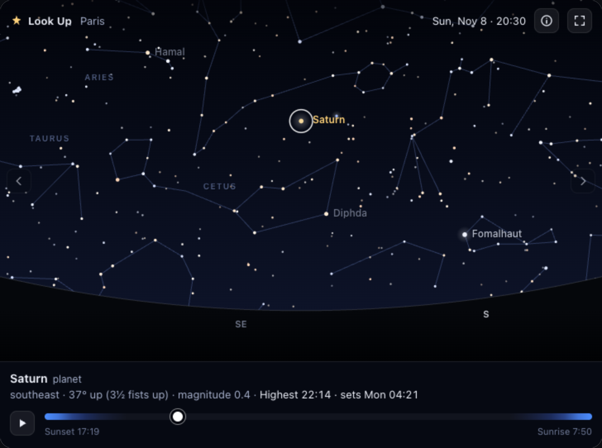
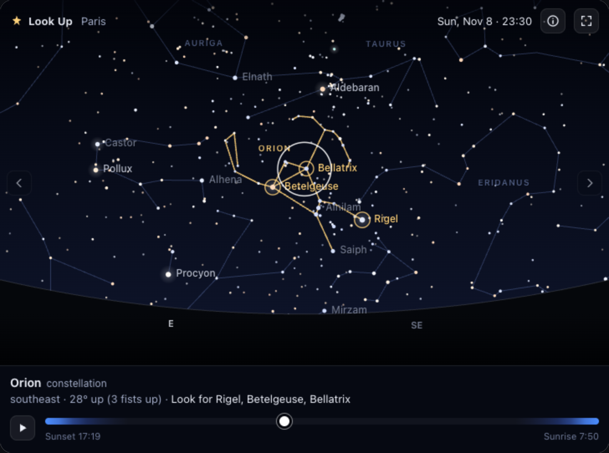
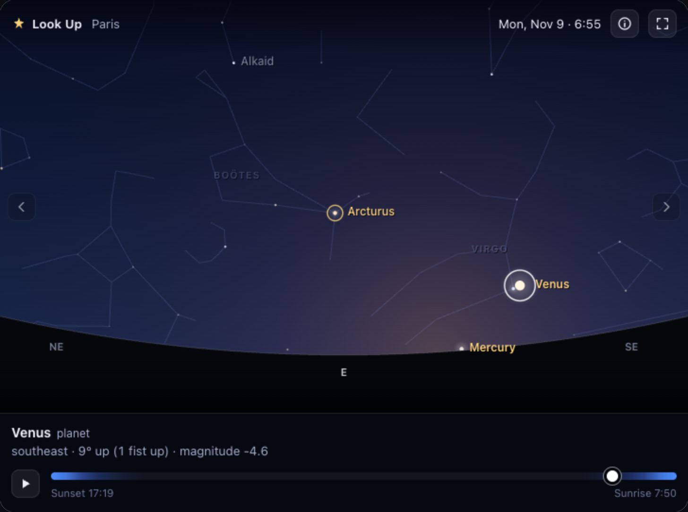

# Look Up

The night sky inside Claude. Ask what you can see tonight, where a planet is, or what that bright "star" is,
and Claude answers with a live sky chart you can drag around and scrub through the night.



## What it does

Four read-only tools. No account, no API key.

| Tool | Ask things like |
| --- | --- |
| `sky_tonight` | "What can I see in the sky tonight from Paris?" |
| `find_object` | "Where's Saturn?" · "Where's Orion?" · "Where's the Big Dipper?" |
| `identify_object` | "What's that bright light low in the east?" |
| `meteor_showers` | "When's the next meteor shower, and will the Moon be in the way?" |

The first three come with an interactive sky chart (an [MCP App](https://github.com/modelcontextprotocol/ext-apps)):
drag to look around, tap a star or planet for details, and drag the time slider or press play to watch the
night go by. Answers use words people use outside: "south-west, about 4 fists up".

It knows the Sun, the Moon and the planets, 2,851 stars down to magnitude 5.5, about 480 named stars, the 88
constellations, famous sights like the Pleiades or the Andromeda Galaxy, and the major annual meteor showers.
Everything is computed by the server and the chart; no other services are called.

| | |
| --- | --- |
|  |  |

## Run it

```bash
uv sync
uv run look-up            # http://127.0.0.1:8000, MCP endpoint at /mcp
```

Then open http://127.0.0.1:8000/demo to try the chart in a browser: the demo page plays the part of Claude and
talks to the chart over the same protocol. `LOOKUP_DEV=1 uv run look-up` rebuilds the chart on every request
while you edit `src/look_up/app/sky.html`. `uv run look-up stdio` serves local MCP clients over stdio.

## Use it in Claude

In Claude, open **Customize → Connectors → Add custom connector** and paste:

```
https://look-up-three.vercel.app/mcp
```

No account or sign-in needed. You can also try the chart in a browser at
[look-up-three.vercel.app/demo](https://look-up-three.vercel.app/demo).

Questions or problems: [open an issue](https://github.com/zadev-cell/look-up/issues).

## Host your own

The public server runs on [Vercel](https://vercel.com): import the repo and deploy, nothing to configure. Vercel
serves the `app` in `main.py` (the MCP endpoint plus the web pages, in stateless mode). Any host that runs
`uv run look-up` with `HOST=0.0.0.0` and `PORT` works too.

For a quick test from your laptop: `cloudflared tunnel --url http://localhost:8000 --http-host-header localhost:8000`
and use the `trycloudflare.com` URL it prints. (The host header flag keeps FastMCP's DNS-rebinding guard happy.)

## Tests

```bash
uv run pytest
uv run ruff check . && uv run ruff format --check .
```

One test runs the chart's in-browser math in Python and checks it puts Saturn, the Moon and Vega where the
server says they are.

The screenshots in `docs/screenshots/` come from `scripts/screenshot.mjs`, which drives headless Chrome against
the demo page (instructions at the top of the file).

## License and credits

Look Up is under the [MIT License](LICENSE). The parts below keep their own licenses.

- Star and constellation data: [d3-celestial](https://github.com/ofrohn/d3-celestial) (BSD-3-Clause). Its stars
  come from the XHIP catalog through the VizieR catalogue access tool, CDS, Strasbourg, France, and its
  constellation figures are adapted from the IAU constellation charts by the IAU and Sky & Telescope magazine,
  under [CC BY 4.0](https://creativecommons.org/licenses/by/4.0/).
- Positions of the Sun, Moon and planets: [Astronomy Engine](https://github.com/cosinekitty/astronomy) (MIT),
  running on the server.
- The chart runs on the [MCP Apps SDK](https://github.com/modelcontextprotocol/ext-apps) 2.0.3 (MIT and
  Apache-2.0), vendored in `src/look_up/app/vendor/`, which bundles the MCP TypeScript SDK, Zod (MIT) and
  @cfworker/json-schema (MIT).
- Built with [FastMCP](https://gofastmcp.com) (Apache-2.0).

Their full notices and license texts are in [`src/look_up/THIRD_PARTY_NOTICES.txt`](src/look_up/THIRD_PARTY_NOTICES.txt).
The server puts them at the top of every copy of the chart it sends, serves them at `/licenses`, and the
chart's ⓘ button shows the credits.
